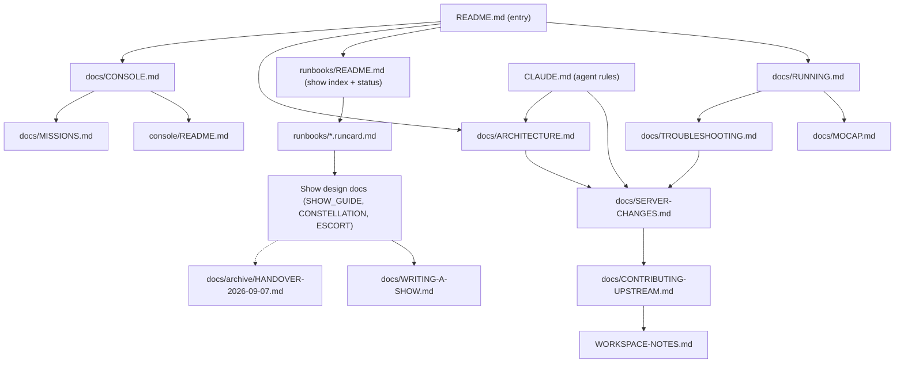

# Documentation consolidation audit, 2026-10-12

**How it was produced:** a read-only workflow over the 34 first-party docs (Haiku mapped each
doc; Sonnet clustered the maps into 32 candidates, verified each against the text and against
code/config where they conflicted, and wrote the plan below). 27 confirmed, 2 rejected,
3 not verified by the workflow (schema failures) and checked by hand instead.

## Status (2026-10-12)

**Applied:** every wrong fact below, i.e. C06 + C05 (the three agent files), C24 (console
formation card and the CONSOLE.md drift note), C01 (Stop timing, the removed Processes tab),
C14 (counterflow 10.5 s; the 99 % carousel figure now dated, with the 94 % four-drone value),
C11 (ESCORT.md arena radius), C12 (arena numbers live in `arena.yaml`, and the
CONTRIBUTING-UPSTREAM "un-rig the arena" item marked done), C31 (`motion_capture.yaml`
comment), C15 (RUNNING.md's stale note about the runcards), and the ROS-distro claim.

**Not yet done:** the restructuring in "Consolidation steps" 4-12 (CLAUDE.md incident
narrative into SERVER-CHANGES, the HANDOVER split, single-owner dedupes, the status column in
runbooks/README.md, and the stale relative dates in the escort Q&A/narrative).

## Spot-checks by hand (Opus, after the workflow)

| ID | Result |
|---|---|
| C01 Stop timing | **confirmed**: `procs.py:43` flight scripts 15 s; MISSIONS.md:408 still says 6 s |
| C06 agent files | **confirmed**: build-doctor.md:29 says to `git clone` over the vendored driver; config-editor and mocap-doctor still describe `pose_bridge.py` `DRONES` |
| C14 carousel | **confirmed**: `choreography.py` counterflow is 10.5 s, SHOW_GUIDE says 9.5 s |
| C24 formation card | **confirmed, and operator-facing**: the console's script card (`catalog.py:90`) says orbit R=1.2 m and "keep 2.24 m clear"; the code has `ORBIT_R = 0.80` |
| C11 escort arena | **confirmed**: ESCORT.md:318 still says `arena_radius = 2.0 m` (it is 1.90) |
| C13 (unverified) | **not real**: the 78 s is a dated five-drone sim record, labelled as history |
| C15 (unverified) | **real, small**: RUNNING.md:408-410 says the runbooks claim Ctrl-C will not land the carousel; the runcard was corrected 2026-10-08 |
| C28 (unverified) | **mostly not real**: `reference/complex-shows-report.html` exists; the other "broken" paths are package-relative shorthand |
| **NEW** ROS distro | **real, missed by the workflow**: this rig has only `/opt/ros/humble`, but CLAUDE.md:243 says "tested by running on Jazzy; Humble is verified by inspection" and README.md:10 leads with Jazzy |

---

# Documentation consolidation plan

## 1. Doc map today

| File | Audience | Purpose | Verdict | Reason |
|---|---|---|---|---|
| CLAUDE.md | Claude, maintainer | Agent rules, gotchas, console rules, conventions | keep, trim | ~900 lines. Move the stall/watchdog/upload narrative (C17) to SERVER-CHANGES. Cut the file tree (C23), formation demo (C24), escort status (C29) and sim arity (C19) to short pointers. |
| README.md | new operator | Setup, config, preflight, flying, LED, layout, doc index | keep, trim | Entry point. Cut the cf6 and two-dongle prose (C02, C03), LED (C20), checklist (C25), and the console section to a pointer. |
| WORKSPACE-NOTES.md | maintainer | Fork status, owed arity PR, hand-back | keep | Owner of branch and PR status. Drop the dated counts (C30). |
| docs/ARCHITECTURE.md | developer | File map, data-flow graphs, symptom lookup | keep | Owner of the file tree and the sim path. Update the "Verified" date (C23). |
| docs/RUNNING.md | operator | Launch runbook, preflight GUI, LED, formation demo | keep | Owner of preflight thresholds (C), scan procedure, LED (H) and the formation demo (B). |
| docs/MOCAP.md | operator | Motive setup, sync, arena survey, streaming | keep, trim | Owner of sync 2b, arena 2c and the Motive 50 Hz settings. Move 3c radio and log tuning to RUNNING G (C25). |
| docs/TROUBLESHOOTING.md | operator | Symptom to fix tables | keep | Owner of build-gotcha rows and UDP 1511 rows. Rewrite "now fixed" wording. |
| docs/CONSOLE.md | operator | GUI action to command map | keep | Owner of the console operator contract, Stop timings and E-STOP. |
| console/README.md | developer | Console internals | keep, trim | Link to CONSOLE.md for operator wording. |
| docs/MISSIONS.md | developer | Mission-window spec format | keep | Fix the Stop timing at line 408. |
| docs/WRITING-A-SHOW.md | developer | Show safety contract | keep, extend | Fix the "Processes -> Stop" text. Receives the live safety rules from HANDOVER. |
| docs/SERVER-CHANGES.md | maintainer | Server diff vs upstream | keep, extend | Owner of stall/watchdog/upload mechanisms. Remove the "CLAUDE.md is wrong" framing (C18). |
| docs/CONTRIBUTING-UPSTREAM.md | fork owner | PR playbook | keep, fix | Stale counts and arena wording (C30). |
| docs/research/2026-10-12-escort-technical-briefing.md | technical meeting | Escort theory and design | keep | Already lists no constants. |
| docs/research/2026-10-11-cbf-commander-feasibility.md | developer | Research note (untracked) | keep | Not in the audit inputs. No verdict beyond committing it. |
| runbooks/README.md | operator | Show index, safety rules | keep, extend | Becomes the owner of hardware status (C29). Replace the inline scan snippet. |
| runbooks/CAROUSEL.runcard.md | operator | Carousel steps | keep | Operator steps owner. Drop the 99% claim. |
| runbooks/CONSTELLATION.runcard.md | operator | Constellation steps | keep | Same. |
| runbooks/ESCORT.runcard.md | operator | Escort steps and defaults table | keep | Owner of the one escort numbers table. |
| runbooks/ESCORT.narrative.md | presenter | Guest script | keep, fix | Dated phrases and numbers become links. |
| runbooks/ESCORT.qna.md | presenter | Q&A card | keep, trim | Delete the Numbers card. Date or remove "this morning" and "yesterday". |
| src/crazyswarm2/crazyflie_shows/SHOW_GUIDE.md | developer, operator | Carousel design and deploy | keep, trim | Replace the 5d/5e operator steps with runcard links. Fix 9.5 s to 10.5 s. |
| .../CONSTELLATION.md | developer | Constellation design | keep, trim | Same as SHOW_GUIDE. |
| .../ESCORT.md | maintainer | Escort design and status | keep, trim | Owner of escort status. Fix the 2.0 m arena claim. Drop the restated defaults. |
| .../HANDOVER.md | maintainer | 2026-09-07 hand-over | split | Live sections 4b, 4d, 5 and 6 go to WRITING-A-SHOW. The rest goes to docs/archive. |
| .../PROVENANCE.md | maintainer | Where the package came from | keep | Covers different history from HANDOVER. |
| .claude/agents/build-doctor.md | Claude | Build agent | keep, fix | Stale git-clone advice (C06). Gotchas become a link. |
| .claude/agents/config-editor.md | Claude | Config agent | keep, fix | Stale `pose_bridge.py` DRONES rule (C06). |
| .claude/agents/mocap-doctor.md | Claude | Mocap agent | keep, fix | Stale apt-driver line (C05) and DRONES line (C06). |
| .claude/agents/preflight-analyst.md | Claude | Preflight judge | keep | Stays self-contained. |
| src/crazyswarm2/README.md, src/motion_capture_tracking/README.md, src/natnet_ros2/README.md, crazyflie_sim/.../visualization/README.md | maintainer, developer | Upstream and vendored READMEs | keep | Not ours to edit. |
| src/motion_capture_tracking/VENDORED.md | maintainer | Why the driver is vendored | keep | Owner of the apt-driver story. |

## 2. Proposed structure

| Topic | Owner |
|---|---|
| Fleet roster | `crazyflies.yaml`, printed by `scan_fleet.sh --list` |
| cf6, cf11 and two-dongle history | one short note in CLAUDE.md |
| Two-dongle channel and datarate rules | CLAUDE.md gotcha (single full statement) |
| Arena numbers | `arena.yaml` |
| Arena survey narrative and recalibration fit | MOCAP.md 2c |
| Recalibration procedure | WRITING-A-SHOW 5.6 |
| initial_position sync procedure and refusals | MOCAP.md 2b |
| Preflight go/no-go table | RUNNING.md section C |
| LED keys and commands | RUNNING.md section H |
| Scan-before-launch | `scan_fleet.sh`, described in RUNNING.md B |
| Formation demo | RUNNING.md B |
| UDP 1511 and read-once rule | TROUBLESHOOTING (mocap pipeline) |
| apt-driver story | VENDORED.md |
| Build gotchas | TROUBLESHOOTING plus README setup |
| Stall, watchdog, upload mechanisms and investigation history | SERVER-CHANGES.md |
| Sim facts (clock, no pose, arity) | ARCHITECTURE section 5 |
| Console Stop timings, E-STOP, cadences | CONSOLE.md (numbers from `procs.py`) |
| Console edit rules | CLAUDE.md (one line each) |
| File tree | ARCHITECTURE Part 1 |
| Diff counts | SERVER-CHANGES.md |
| Hardware status per show | runbooks/README.md table |
| Operator steps per show | runbooks/*.runcard.md |
| Escort numbers | ESCORT.runcard.md table, with `plan_escort` as the authority |
| Carousel separation | `plan_show` output |
| Branch and arity-PR status | WORKSPACE-NOTES |

## 3. Conflicts to fix first

| ID | Conflict | Correct value and source |
|---|---|---|
| C06 | build-doctor says to `git clone` over the vendored `src/motion_capture_tracking`. config-editor and mocap-doctor say `pose_bridge.py` `DRONES` must be kept in sync. | The driver is vendored (VENDORED.md), so never clone or apt-install it. `scripts/pose_bridge.py` reads its roster from `crazyflies.yaml`, and only `PUBLISH_HZ=50` needs matching. |
| C05 | mocap-doctor.md:31-32 treats the apt driver as current. | "The vendored driver requires Multicast or Broadcast. Never apt-install it." Source: VENDORED.md, enforced by `launch.py check_vendored_mocap_driver`. |
| C24 | `catalog.py` SCRIPT_NOTES (lines 90-91) says R=1.2 and ~2.24 m. | `ORBIT_R = 0.80` in `multi_trajectory_formation.py`. The card should say the demo plans against the arena before arming, so read the banner. Then delete the "Known drift" bullet in CONSOLE.md. |
| C01 | MISSIONS.md:408 says SIGTERM comes after 6 s. WRITING-A-SHOW:63 names the removed "Processes -> Stop". | `procs.py:43-47`: flight scripts get SIGINT, then SIGTERM after 15 s, then SIGKILL. Other processes get 6 s. The UI is the Dashboard output pane. |
| C14 | "99% of separation budget" is stated as current in runbooks/README, CAROUSEL.runcard and WRITING-A-SHOW. SHOW_GUIDE:591 says a 9.5 s counterflow. | The counterflow is 10.5 s (`choreography.py:196`). The separation figure depends on the marks, so use the `plan_show` output. The dated 99% vs 94% record stays in SHOW_GUIDE section 1. |
| C11 | ESCORT.md:318 says `arena_radius = 2.0 m`. | 1.90 m (`ARENA_RADIUS_PLAN` = 2.00 tested - 0.10 margin; `escort.py:340`). |
| C12 | MOCAP.md:131, CONTRIBUTING-UPSTREAM:66 and 164, and WRITING-A-SHOW:136 say `safety.py` holds the arena numbers. | `arena.yaml`, read by `safety.py`. The ceilings of 1.85 and 2.32 are both correct (full radius vs centre), so state that once. |
| C29 | RUNNING.md:376 points to a status table in runbooks/README.md that has no status column. | Add the column (step 11). |
| C31 | `motion_capture.yaml:18` has a stale "# 240.0 Hz" comment. | The deadline is 50.0. |

## 4. Consolidation steps

Ordered by value over effort.

1. **Fix the three agent files** (C06, C05, C21 Humble wording). Point them at CLAUDE.md, VENDORED.md and `scripts/pose_bridge.py`. Add arena.yaml, `telemetry_watchdog_s` and `keepalive_frequency` to config-editor.
2. **Fix `catalog.py` SCRIPT_NOTES** (C24), then delete the "Known drift" bullet in CONSOLE.md.
3. **Fix the wrong numbers in prose** (C14, C11, C01, C31, C12):
   - SHOW_GUIDE:591 and ESCORT.md:318.
   - The "99%" lines in runbooks/README, CAROUSEL.runcard and WRITING-A-SHOW.
   - The "Processes -> Stop" text and the MISSIONS.md:408 timing.
   - The `motion_capture.yaml:18` comment.
   - The `safety.py` wording in MOCAP, CONTRIBUTING-UPSTREAM and WRITING-A-SHOW.
4. **Move the CLAUDE.md incident narrative into SERVER-CHANGES** (C17, high value). Add an "Investigation history" subsection covering the counter semantics, packet-trace localisation, the 2026-10-05 and 2026-10-06 findings, and the ruled-out lists. Leave CLAUDE.md with about 15 lines of DO NOTs:
   - No default argument on `start()`.
   - Keep the `bad_trajectories_` refusal.
   - Do not "fix" `requestMemoryToc`.
   - Bound waits before calling them from service handlers.
   - The callback group is fleet-wide.

   Keep the second-Crazyradio probe and supervisor-LOCKED entries. Re-point TROUBLESHOOTING rows 41-42 at SERVER-CHANGES.
5. **Split HANDOVER.md** (C04):
   - Move sections 4b, 4d, 5 and 6 into WRITING-A-SHOW as "Safety rules".
   - Move the rest to `docs/archive/HANDOVER-2026-09-07.md`.
   - Update the section-number citations: about 20 in SHOW_GUIDE, plus swarm_show.py, figures.py, choreography.py, escort.py, `crazyflies.yaml:50`, README:772 and CLAUDE.md:105.
   - Fallback: delete the dangerous sudo steps and keep the banner.
6. **Collapse the escort numbers** (C10). Keep one table in ESCORT.runcard, labelled a snapshot of `EscortConfig`. Delete the Q&A Numbers card. Replace the narrative's separation and speed numbers with a link. Drop the restated defaults from ESCORT.md. Merge the runcard's two "marks not written here" notes.
7. **Date or remove the stale phrases in ESCORT.qna and ESCORT.narrative** (C11): "this morning", "yesterday", "not today", "very little hardware time".
8. **Make runbooks/README.md the status and scan owner** (C29, C16):
   - Add a "Hardware status" column: carousel flown 2026-09-17, constellation sim-only, escort flown 2026-10-07/08 with the walking VIP not cleared.
   - Replace the inline python scan snippet with `./scripts/scan_fleet.sh`.
   - Change the three runcard placeholders to the literal command.
   - Replace HANDOVER's hard-coded address.
   - Trim the CLAUDE.md escort status to one line.
9. **Make operator steps live only in the runcards** (C25). In SHOW_GUIDE 5b-5e, ESCORT.md "Operator-paced", "Manual control" and "Before any hardware flight", and CONSTELLATION 0 and 5, keep the rationale and link the commands. Merge the README section 5 and RUNNING.md C checklists, then link. Move MOCAP 3c radio and log tuning to RUNNING G.
10. **Single-owner topic dedupes** (small each):
    - Preflight thresholds (C08) to RUNNING C. Fix the "crazyflies.yaml thresholds" wording and add a comment next to the constants in the plotter.
    - LED (C20) to RUNNING H. Delete the section F block and cut README section 7.
    - Sync (C32) to MOCAP 2b. Shorten the CLAUDE.md gotcha and the README:369 collision story.
    - Recalibration (C26): numbers in MOCAP 2c only, procedure in WRITING-A-SHOW 5.6.
    - UDP 1511 (C07): full text in TROUBLESHOOTING only. Shrink the CLAUDE.md gotcha and the ARCHITECTURE table cells.
    - Roster, cf6 and cf11 (C02, C03): one note in CLAUDE.md. Trim README:58-75, RUNNING:425-440 and MOCAP:223-235, and fix "five or six" and "six".
    - Telemetry rates (C31): link instead of copying. Delete "was 240" in MOCAP 3b.
    - Build gotchas (C21): fix the "now installs" and "Fixed in current scripts" wording.
11. **Trim the structure and status copies** (C23, C22, C24, C19):
    - Cut the CLAUDE.md tree (56-143) to a short list.
    - Update the ARCHITECTURE "Verified" date.
    - Make SERVER-CHANGES the only place for diff counts.
    - Cut the CLAUDE.md formation-demo bullet to about 5 lines, linking RUNNING B.
    - Cut the CLAUDE.md arity paragraph to 2-3 lines, with ARCHITECTURE section 5 as owner.
    - Cut the console copies in README section 8, ARCHITECTURE section 8 and console/README to links. CLAUDE.md keeps one line per rule.
12. **Refresh the maintainer snapshots** (C30, C18):
    - CONTRIBUTING-UPSTREAM: replace the 61 ahead and 445/22 figures with commands. Live values were 0/76 and +524/-22 on 2026-10-12. Rewrite the "Un-rig the arena" item.
    - SERVER-CHANGES: drop the "CLAUDE.md is wrong" framing, retitle section 6, and drop the exact-totals table.
    - WORKSPACE-NOTES: drop the hash-dated detail.

## 5. Leave alone

- **Runbooks restating commands for operators.** A runcard must be usable standing at the rig with no link-following.
- **Runcard defaults, scan and abort steps.** These are intended operator content (C32, C25). Only the numbers and procedures with another owner get linked.
- **preflight-analyst.md thresholds.** Agents may not follow links, so it stays self-contained. Add a comment naming RUNNING C and the plotter as the sources.
- **CLAUDE.md binding rules.** The console edit rules, the supervisor-LOCKED entry, the second-radio probe and the short UDP 1511 gotcha stay, because Claude reads that file before editing.
- **use_sim_time callouts** in RUNNING, README, SHOW_GUIDE and WRITING-A-SHOW. The flag has to sit next to the command.
- **CONSTELLATION.md and SHOW_GUIDE flight records, and the sim visualization README example.** These are dated records, pointers or examples, not roster claims.
- **ARCHITECTURE.md:242-257 verification record.** It is correctly labelled history.
- **ARCHITECTURE.md:464 and :514, and CLAUDE.md:47-49.** They are already one-line pointers.
- **ESCORT.md frame warning and old-frame passages.** Already labelled correctly.
- **CONSOLE.md scan-fleet row.** The console's `/api/scan_fleet` checks datarate, which the script does not, so the difference is real.
- **TROUBLESHOOTING symptom tables.** The Color LED rows and the other rows are diagnostic rows, not duplicate narrative.
- **HANDOVER.md vs PROVENANCE.md.** Different history, so do not merge them.
- **The 1.85 vs 2.32 ceilings.** Both are correct (cone ends), so clarify rather than "fix".
- **The briefing's "no constants" stance and the upstream or vendored READMEs.**