# The escort demo: theory and design

*A briefing for a technical meeting, 2026-10-13. It covers the ideas behind each algorithm and
why each design decision was taken, not every constant. For exact numbers, run
`ros2 run crazyflie_shows plan_escort` (it reads the live config). The earlier version of this
file, which lists the constants and the doc corrections, is in git at `9e9bf8a`.*

*The figures are computed by calling the real escort code
([`escort_figures.py`](escort_figures.py)), so they show what flies.*

---

## 1. The problem, in one picture

Three small drones must keep a moving, hand-flown VIP (a DJI) protected from a fourth drone
that is trying to reach it. Two facts constrain everything:

* **Nothing can sense anything.** Positions come only from motion capture, so the system is
  **centralised**. One laptop knows every position and decides for every drone.
* **Nothing can avoid anything.** The Crazyflies have no onboard collision avoidance, so
  **every safety property has to be enforced in the commands** before they leave the laptop.

The design splits the problem into four layers, each answering one question:

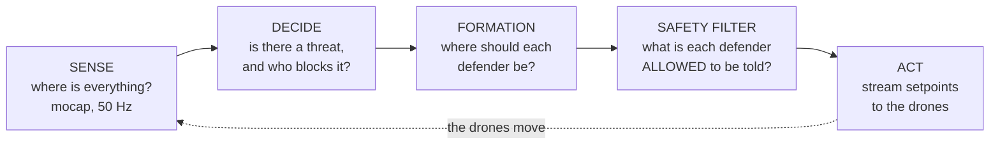

Each layer is replaceable on its own. The safety filter does not care how the formation was
chosen, and the formation does not care how the threat was detected. This separation is the
main architectural decision, and it is what lets one offline verifier check the whole chain.

---

## 2. System architecture

### 2.1 Who computes what

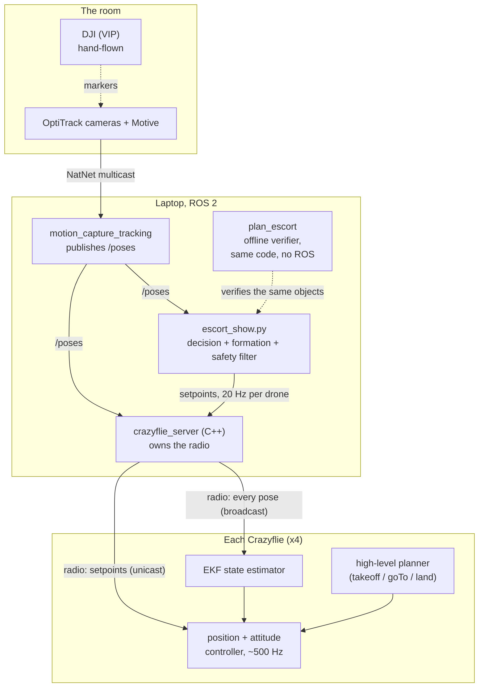

### 2.2 A cascade of control loops on separate time scales

This is classic **cascaded control with time-scale separation**. Each outer loop is slow
compared with the loop inside it, so it can treat that inner loop as "a drone that goes where
it is told, with some lag":

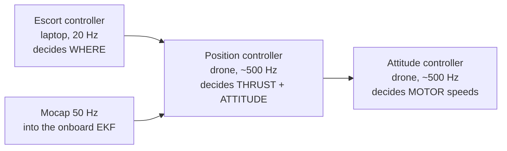

The escort never commands attitude. It moves a **position target** (plus a velocity
feedforward). That is also why the offline verifier can model each drone as a simple
first-order lag: from the escort's point of view, that is what the inner loops look like.

### 2.3 Two command modes, and the switch between them

The Crazyflie offers two ways to be told where to go, and the escort uses both.

| | **High-level** (`takeoff`, `goTo`, `land`) | **Streaming** (`cmdFullState`) |
|---|---|---|
| You send | one goal and a duration | a new setpoint every tick |
| Path planned by | the **drone** (smooth 7th-order polynomial) | the **laptop** |
| After sending | the drone flies the leg on its own | the laptop must keep sending, or the drone gives up |
| Good for | known moves: takeoff, gather, landing | reacting to something that moves |

The firmware arbitrates between them by **priority**. A streamed setpoint outranks the onboard
planner, so the first one silently takes over. `notifySetpointsStop` hands control back, and
also tells the planner where the drone *really* is, so the landing starts from the right
place:

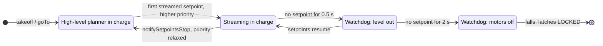

**Design consequence:** once a drone is streaming, *every* code path must keep feeding it,
including while the show waits on a human. That is why the "waiting" gates in §7 keep the
whole control loop running instead of sleeping.

### 2.4 One control tick, end to end

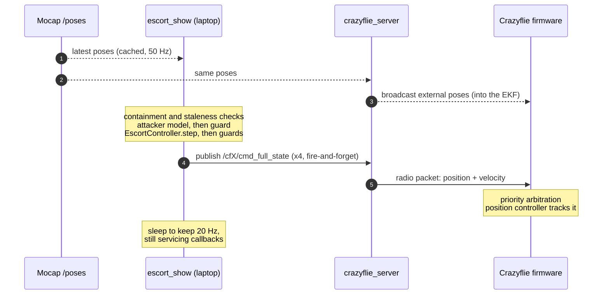

---

## 3. The formation: a ring that turns, not drones that swap

### 3.1 The formation as a virtual rigid body

The ring is a **virtual structure** (Lewis & Tan, 1997). The formation is treated as one rigid
body with a few parameters, and each drone simply tracks its own point on that body:

$$
p_k^{\ast} = p_{\text{VIP}} + R\begin{bmatrix}\cos(\psi + \theta_k)\\ \sin(\psi + \theta_k)\end{bmatrix},
\qquad \theta_k = \tfrac{2\pi k}{3}\ \text{(at rest)}
$$

The whole formation has **three degrees of freedom**: the centre (the VIP's position, which is
*given*) and one angle ψ (which is *chosen*). Controlling one angle instead of three drones
is what keeps the decision logic small enough to reason about.

The ring geometry follows circular-formation-around-a-leader work (arXiv 2212.12554, in the
Olfati-Saber line). The potential fields those papers use were dropped. With mocap every
position is known exactly, so a direct slot target plus a saturated tracking law does the
same job with nothing to tune.

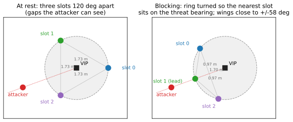

### 3.2 Why rotate instead of reassigning

The textbook way to "put a defender in front of the threat" is **reassignment**: solve an
assignment problem (e.g. the Hungarian algorithm) and send the best-placed drone there. Here
that is the wrong move:

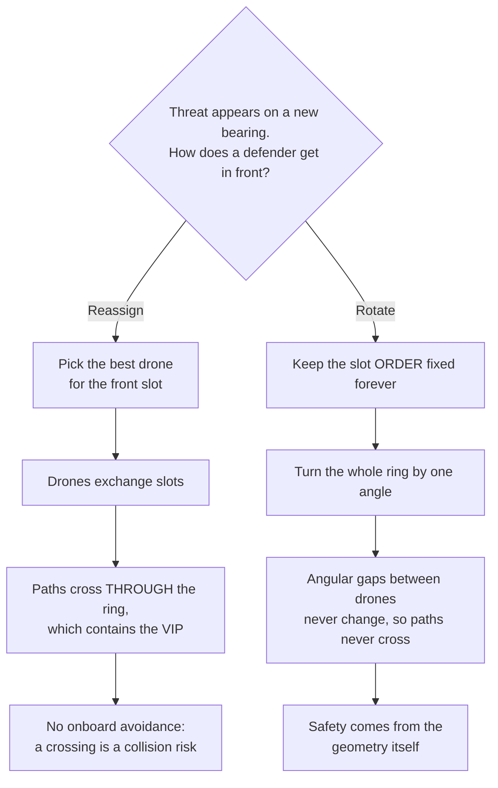

**The invariant:** slot order is fixed once, at the gather, from the drones' bearings around
the VIP (counter-clockwise order). After that, rotation preserves cyclic order. Two drones
can never pass each other, because their angular separation is constant. Only the separation
*distance* needs watching, and §5 handles that.

The initial phase is chosen as the **circular mean** of each drone's bearing minus its slot
angle. That is the angle that minimises total turning to reach the slots, i.e. it maximises
$\sum_k \cos(\beta_k - \theta_k - \psi)$.

### 3.3 Which defender blocks: nearest slot, with hysteresis

The defender that blocks is not fixed. It is **whichever slot is already nearest the threat
bearing**. Because three slots are 120° apart, every bearing is within 60° of some slot, so:

> **The ring never has to turn more than 180°/n = 60°** to put a defender on the threat.

Always using "slot 0" would sometimes need a 180° turn, which no drone can fly in time.

The choice is re-evaluated every tick, but another slot only takes over when it is better
**by a margin** (hysteresis). Otherwise a threat sitting exactly between two slots would flip
the blocker every tick and the ring would judder.

### 3.4 The wall: blending, never switching

Once engaged, the two wings leave their 120° posts and close up beside the blocker, so the
attacker faces a wall instead of one drone with large gaps either side (right panel above).

Theory points:

* The transition is a **homotopy**. A scalar `close ∈ [0,1]` ramps over a few seconds, and
  each wing's angle blends from rest to its wall post. Switching instantly would make the
  targets jump, and a target jump is a drone commanded to fly at its maximum speed.
* The blend goes along the **shortest arc**, not by interpolating the raw angle values.
  Interpolating raw values once sent a wing the long way round, straight through the
  blocker's post.
* **The wall's width is limited by the separation floor.** The blocker–wing distance is the
  chord $2R\sin(\alpha/2)$. Shrinking the ring therefore *forces* the wall to open, which is a
  geometric coupling between two parameters that look independent.

---

## 4. Deciding: when to block, and how fast to turn

### 4.1 The engagement latch is a Schmitt trigger

Blocking engages when the attacker comes within an **alert radius** of the VIP and releases
only beyond a **larger** release radius. This is a Schmitt trigger. The gap between the two
thresholds absorbs noise and small oscillations, so the mode cannot chatter.

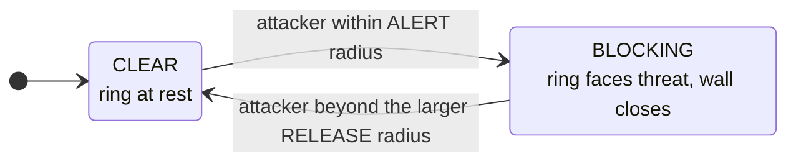

**Choosing the threshold is a timing problem, not a geometry problem.** The ring needs a few
seconds to turn, so it must start turning while the attacker is still out of reach. The
alert radius was raised after a live run in which the attacker got through. It had to
engage *earlier* to buy time, not hold a different shape.

On release, the ring **holds its current angle** instead of winding back to a "home" angle.
Winding back produced a limit cycle: the attacker retreats, the ring spins home, the attacker
returns, the ring spins out again.

### 4.2 The ring turns at a bounded rate

The phase follows its target through a **slew-rate limiter**:

$$
\psi_{t+1} = \psi_t + \operatorname{clamp}\!\big(\operatorname{wrap}(\psi^{\ast} - \psi_t),\ -\omega\,\Delta t,\ +\omega\,\Delta t\big)
$$

This bounds how fast any slot can move ($R\omega$), it makes the motion readable for an
audience, and it makes the ring immune to a target that jumps (a mocap glitch, or the
attacker crossing behind the VIP). Two rates are used. The ring turns gently at rest, and
faster while blocking, because during an encounter the VIP is meant to hold still and the
speed budget (§4.3) is better spent on turning.

**Prediction was tried and rejected.** Aiming ahead of the attacker by its measured bearing
rate sounds better than chasing where it is. Measured, it was worse: once the blocker is
re-selected every tick, the ring is already on the threat, and leading only walks it off.
*Re-selecting who blocks beat predicting where the threat will be.*

### 4.3 The speed budget: the central trade-off

A defender's velocity is the sum of following the VIP and travelling round the ring:

$$
v_k = v_{\text{VIP}} + \omega R\,\hat t_k
\quad\Rightarrow\quad
\lVert v_k\rVert \le \lVert v_{\text{VIP}}\rVert + \omega R \le v_{\max}
\quad\Rightarrow\quad
\lVert v_{\text{VIP}}\rVert \le v_{\max} - \omega R
$$

Every defender has one speed cap, and turning and following draw on the same budget. The
faster the ring turns, the less the VIP may move. While blocking, the ring turns fast enough
that almost nothing is left over. **This one inequality explains why the walking-VIP case does
not clear verification**, and why the pilot is briefed to hold the DJI still during an attack.
The levers are all visible in the formula: a slower turn (a lazier block), a smaller ring
(less clearance from the VIP), or a higher speed cap (a safety decision about flying faster
near people).

### 4.4 The controller step, as a flowchart

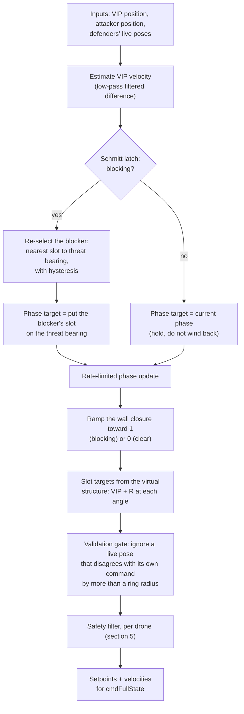

The validation gate is the same idea as gating in target tracking. A measurement wildly
inconsistent with what you expect is more likely a bad measurement (a stale pose, a flipped
rigid body) than a real event, so it is not acted on.

---

## 5. The safety filter: every setpoint is checked

### 5.1 What it does

Every target, for every drone, every tick, goes through the same three stages in a fixed
order:

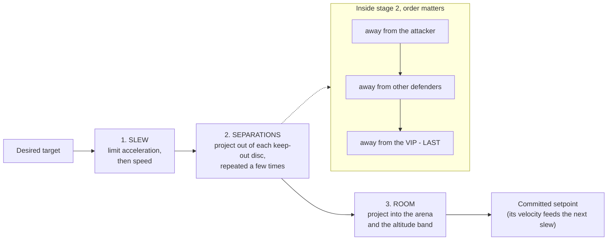

### 5.2 The theory behind it

* **Slewing is a reference governor.** Saturating the change in velocity, then the velocity
  itself, turns an arbitrary target sequence into one a real double-integrator-like vehicle
  can follow.
* **Each separation is a projection.** "Stay at least *d* from point *c*" is the set outside
  a disc. Its nearest-point projection is a radial push:
  $p \leftarrow c + d\,\frac{p - c}{\lVert p - c\rVert}$ when $\lVert p - c\rVert < d$.
* **Several constraints means cyclic projection**, the same idea as alternating projections
  or POCS. For *convex* sets cyclic projection converges to a point in the intersection. The
  outside-of-a-disc sets are **not convex**, so there is no convergence guarantee. The design
  therefore uses a **fixed number of passes and a fixed order**, and ends on the constraint
  that matters most. **The last projection always holds**, so finishing on the VIP makes the
  VIP separation the one that is never traded away. That is a *priority ordering*, made
  explicit.
* **Order between stages matters too.** If you clamp the separation first and slew second,
  the slew (which interpolates from the previous setpoint) drags the drone straight back
  inside the floor. An earlier prototype shipped exactly that bug.
* **Feasibility is kept by the layer above.** The room clamp runs after the VIP clamp, so on
  its own it could push a defender back toward the VIP. The **geofence** (§6) prevents that
  situation: it only lets the ring follow the VIP while the whole ring fits inside the arena.
  Two constraints are only compatible if something upstream keeps them compatible.

### 5.3 Who gives way

When an attacker and a defender converge, *someone* must yield. Reciprocal methods (e.g. ORCA,
van den Berg et al. 2011) split the effort evenly. Here it is deliberately **asymmetric**:

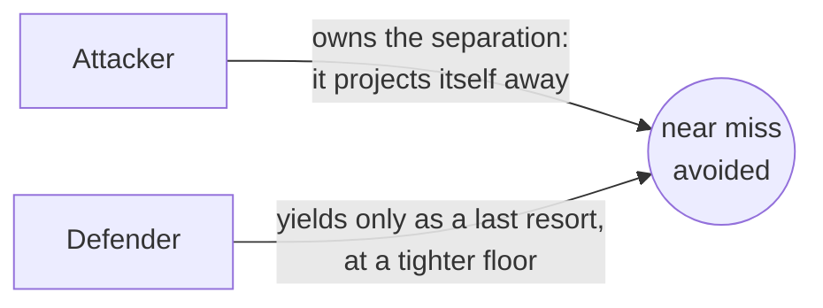

If defenders yield first, the ring can never be an obstacle. Measured before the change, an
attacker driving straight in pushed the blocker out of the way and ended up beside the VIP.
Every separation was honoured and the defence did nothing. Assigning avoidance to the
attacker is what turns the defenders into a real wall.

### 5.4 What it is not: a control barrier function

A **control barrier function (CBF)** safety filter (Ames et al.) solves a small optimisation
each tick. It finds the minimally changed command that satisfies *all* constraints jointly,
with a proof that the safe set stays invariant over time. Our filter is simpler: no solver,
cheap, easy to reason about. But it is a heuristic. It guarantees the setpoint-level VIP
separation by construction, and everything else is verified by simulation (§8), not proven.
Moving to a CBF is the subject of the 2026-10-11 research note.

---

## 6. Defence in depth: the safety layers in time

No single mechanism is trusted. Each layer catches what the one before it can miss, and the
layers are ordered by *when they can act*:

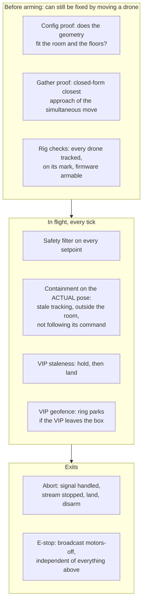

Three design ideas worth naming:

* **Check the plant, not the command.** Clamping a setpoint proves nothing about the
  aircraft. On 2026-10-07 the attacker flew away while its *commanded* point stayed inside the
  arena. Containment therefore watches each drone's measured position and its **tracking
  error**. A drone that stops following is the earliest warning there is, and it shows up
  before the drone leaves the room.
* **An exact gather check, because of how goTo works.** All drones start the gather at the
  same time with the same duration, and the onboard planner uses the same normalised timing
  curve for each. Every drone is therefore at the same *fraction* $\sigma(t)$ of its
  straight-line leg at every instant, so each pair's relative position is linear in σ. The
  minimum distance is then the closed-form **closest point of approach**,
  $s^\ast = \operatorname{clamp}\!\big(-\tfrac{d_0\cdot\Delta}{\lVert\Delta\rVert^2},0,1\big)$,
  and it is *exact*, not sampled.
* **Graceful, ordered responses.** Lose the VIP briefly and the ring holds. Lose it longer and
  everything lands. Let the VIP stray and the ring **parks** rather than chasing it into a
  wall. Re-acquiring needs *two* conditions (back inside the arena **and** back inside the
  parked ring), so a returning DJI cannot drag the whole formation across the room. Both
  thresholds use hysteresis, for the same reason as §4.1.

---

## 7. The human in the loop

A run involves an operator, a pilot flying the DJI, and autonomous drones. Running that on a
wall clock forces everyone to be ready at a moment nobody chose. The show is therefore
**operator-paced**: the attacker's progress waits for the operator, but **the defence never
waits for anybody**.

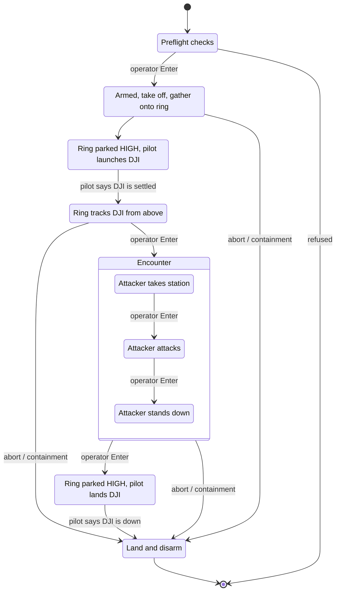

Design decisions here:

* **First in, last out.** The small drones are up before the DJI and come down after it, so
  the large aircraft never manoeuvres past three hovering ones.
* **Above, never below.** While the DJI climbs or descends, the ring is parked high. During
  the escort it rides *above* the DJI, because downwash from a larger aircraft overhead is
  the one geometry a 30 g drone does not survive. Flying level with it was tried first and
  rejected: in the same plane, any sideways slip by the pilot becomes a collision.
* **Waiting is not sleeping.** While a gate waits for a human, the full control loop keeps
  running (guards, watchdogs, the setpoint stream). A gate that simply blocked froze the pose
  timestamps, and the operator's reaction time was read as a mocap dropout.
* **Lights carry state.** Colour shows each drone's *role* (blocker, wing, resting, attacker)
  and the *stage* of the show, so the operator can check from across the room that drones and
  script agree. One colour per meaning: when two meanings shared a colour, the operator could
  not tell them apart in flight.

---

## 8. The adversary: a deliberately beatable opponent

There are two attackers. The **scripted** one flies fixed legs, so every leg can be proven
before takeoff; it serves as the verifiable baseline. The **reactive** one, flown for guests on
2026-10-08 and now the default, improvises. Its design goal is unusual: it must look
aggressive, never be the same twice, and **lose in a way we can reason about**.

### 8.1 An artificial potential field

The reactive attacker is a classic **artificial potential field** (Khatib, 1986): it is pulled
toward a goal, pushed by obstacles, and its speed is capped:

$$
v = k_a\,\min\!\Big(1, \tfrac{d_{\text{goal}}}{b}\Big)\hat u_{\text{goal}}
\;+\; \sum_{\text{defenders}} k_r\Big(1 - \tfrac{d_j}{\rho}\Big)_{\!+}\hat u_{\text{away},j}
\;+\; \text{wall term},
\qquad \lVert v\rVert \le v_{\max}
$$

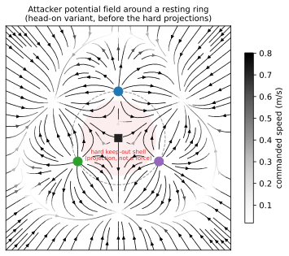

Potential fields have well-known failure modes: local minima and oscillation (Koren &
Borenstein, 1991). This one had a specific one, visible in the figure. **Inside the ring, the
three defenders' repulsions add up to a push toward the centre, which is onto the VIP.** No
gain tuning fixes that, because the problem is the geometry. The fix was to stop relying on
forces for the hard limits. After each step the attacker's point is **projected** out of a
keep-out shell around the VIP and out of each defender's separation disc, the same projection
idea as §5. **Forces make it look like it is avoiding; projections make it actually avoid.**

### 8.2 Behaviour on top of the field

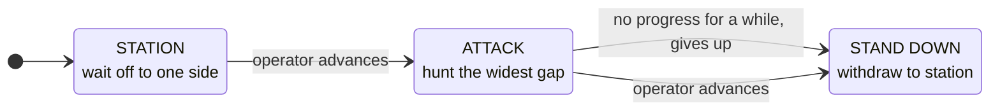

* **Gap seeking.** Instead of driving straight at the VIP (which only bounced it in and out on
  one line and never made the ring move), it aims at the **widest gap** between defenders,
  with a bias toward gaps far from where it already is, so it flanks. It **commits** to a gap
  until a defender closes it, the same hysteresis idea as before. Without commitment it
  re-chose every tick and dithered between two gaps.
* **Giving up.** It tracks the closest it has managed to get. That best distance slowly
  *relaxes* outward, so repeated pressing counts as trying. If it fails to beat its own best
  for long enough, it stands down. Without the relaxation, a single good approach became an
  all-time record it could never beat again, and it quit mid-attack.

### 8.3 Why the defence can win: the race is angular

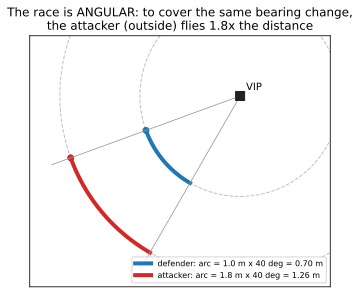

The defenders do not need to be faster. They need to **turn** faster. Both sides are
contesting a *bearing* around the VIP, and the defenders sit on the inside track. To cover
the same change in bearing, the attacker (held outside the ring) travels proportionally more
distance:

$$
\omega_{\text{attacker}} = \frac{v_{\text{attacker}}}{r_{\text{attacker}}}
\qquad\text{vs}\qquad
\omega_{\text{ring}} \le \frac{v_{\max}}{R}, \quad R < r_{\text{attacker}}
$$

The block holds when the attacker's angular rate is below the ring's, which gives a concrete
break-even attacker speed. One caveat to be honest about: the argument assumes the defenders
*keep* the attacker out at the larger radius. Closer in, the same arithmetic favours the
attacker. This is the classic **target-guarding** setting from differential games (Isaacs),
here solved by a heuristic, not an optimal strategy.

A practical detail: the attacker's *planner* runs faster than the defenders, but its commands
go through the same safety filter as a defender's. The aircraft is therefore no faster than a
defender. The offline verifier skips that filter, so it tests against a harder attacker than
the one that flies.

---

## 9. One encounter, end to end

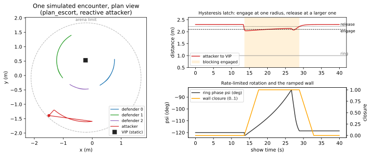

Read it as the theory in action:

* **Left:** the defenders' paths are arcs. They only ever travel *round* the ring, never
  across it, because the slot order is invariant (§3.2). The attacker's path is its own,
  shaped by the field and the gaps (§8).
* **Top right:** the Schmitt latch (§4.1). The attacker comes inside the engage line, the
  shaded band begins, and blocking holds until it retreats past the *higher* release line.
* **Bottom right:** the phase turns at a bounded rate, a ramp rather than a step (§4.2). The
  wall closure ramps smoothly up and back down (§3.4).

---

## 10. How it is verified

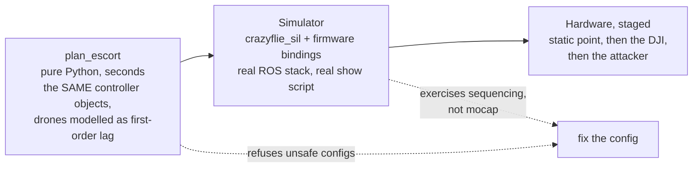

* **Software-in-the-loop with the identical code.** `escort.py` is pure (no ROS, no radio), and
  both the verifier and the flight script import the *same* objects. What passes offline is
  exactly what is commanded in flight. Only the plant is swapped for a model.
* **Property-based verdicts**, measured over a whole simulated encounter, not a single snapshot:
  every separation, peak speed, room radius, altitude, and **formation error**. A run where
  the guard rescued every separation but the ring stopped being a ring counts as a *failed*
  escort.
* **Sweeps map the envelope.** For example, the fastest VIP walk at which every property still
  holds. That gives a number to quote, not an anecdote.
* **Honest limits.** The plant model is a stand-in, not a measured response. The simulator
  publishes no mocap, so the pose-handling paths are first exercised on hardware. Hardware
  margins for the escort have not been measured.

---

## 11. Lessons that generalise

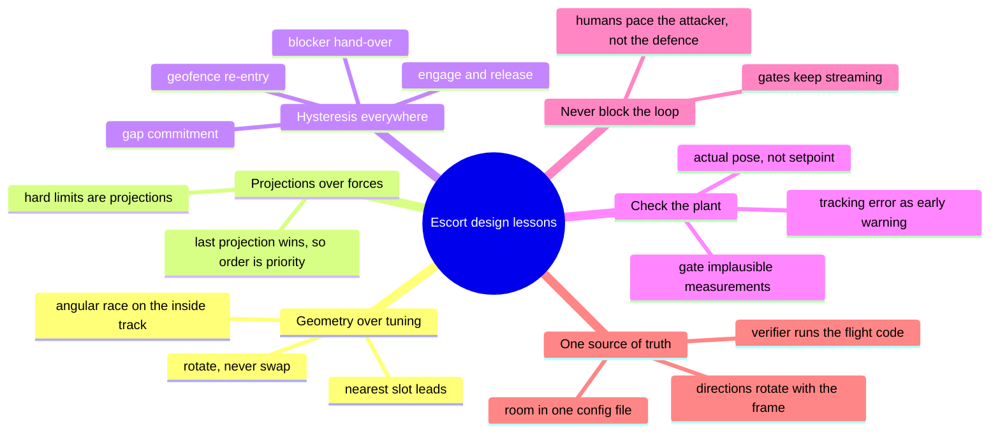

The last item came from a real failure. On 2026-10-08 Motive was recalibrated and the world
frame rotated by about 92°. **A point transforms with rotation and translation; a direction
transforms with rotation only.** The arena centre (a point) was carried across, but three
*directions* (where the VIP stands relative to the centre, and the attacker's two entry
bearings) were not, which put the attacker's waiting station outside the arena. The verifier
caught it before anything flew.

---

## 12. Open questions

| Question | Why it is open | Where it points |
|---|---|---|
| Can the VIP walk? | The speed budget (§4.3) leaves almost nothing while blocking; verification does not clear a moving VIP | slower turning, a bigger room, or a higher speed cap |
| Can the separations be *proven*? | The safety filter is a heuristic projection (§5.4) | a CBF filter: the 2026-10-11 research note |
| How good is the model? | The verifier's drone model is assumed, not measured | log hardware runs, fit the lag, add a tracking margin |
| Is the attacker modelled as flown? | The verifier skips the attacker's safety filter (§8.3) | route it through the same filter offline |
| How does tracking hold up with an audience? | Occlusion near the arena edge on demo day is unexplained | `watch_escort.py` logs on every run |
| Attacker starved during a VIP dropout | Known code path; parked for now | stream the attacker in that hold branch too |

**References named in this document:** Lewis & Tan 1997 (virtual structures); arXiv 2212.12554
(circular formation around a leader); Olfati-Saber 2006 (flocking); Khatib 1986 (artificial
potential fields); Koren & Borenstein 1991 (their limitations); van den Berg et al. 2011
(ORCA, reciprocal avoidance); Ames et al. 2019 (control barrier functions); Isaacs 1965
(differential games, target guarding); Preiss et al. 2017 (Crazyswarm, onboard planning).
